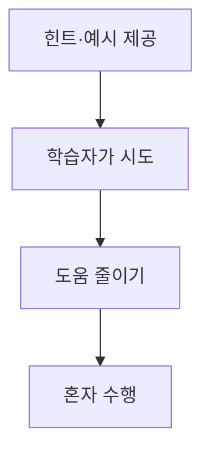

# 근접발달영역

> **근접발달영역(ZPD)** 은 학습자가 **혼자서는 못 하지만 도움을 받으면 할 수 있는** 범위다. 너무 쉽지도 너무 어렵지도 않은 이 구간에서 가르칠 때 학습이 가장 잘 일어난다고 본다.

## 쉽게 말하면
자전거를 배울 때 보조바퀴(도움)가 있으면 타지만 떼면 넘어지는 단계다. 이미 혼자 타는 일은 연습할 필요가 없고, 아직 근처에도 못 간 일은 도움을 줘도 소용없다.

## 자세히
(Wikipedia "Zone of proximal development" 확인)
- **정의**: 교육심리학 개념으로, 학습자가 **도움 없이 할 수 있는 것**과 **도움이 있어도 못 하는 것** 사이의 공간. 교사나 더 아는 동료(more knowledgeable other)의 도움이 있을 때만 수행 가능.
- **비고츠키**(1896–1934): 생애 마지막 3년 동안 이 개념을 제시했으나 완전히 발전시키지는 못했다. 아이의 지능은 혼자 할 수 있는 것보다 **도움을 받아 할 수 있는 것**으로 더 잘 판단되며, 발달은 대화와 사회적 상호작용을 통해 일어난다고 보았다.
- **스캐폴딩(비계)**: 비고츠키가 쓴 용어가 아니다. Bruner, Wood, Ross가 ZPD를 교육에 적용하며 발전시켰다. 필요한 만큼 도움을 주고 학습자가 필요 없어지면 **서서히 줄이는** 과정으로, 건물이 완성되면 비계를 걷는 것에 비유된다.
- **AI 활용**(권고): 학습 노드를 고를 때 "이미 아는 것"과 "너무 먼 것" 사이를 찾는다. AI에게 "내가 막힌 지점의 바로 앞 단계 개념부터 힌트를 단계적으로 줘"라고 요청하고, 도움을 점차 줄여 달라고 한다([재귀적 공백 채우기](#recursive-gap-filling)).

## 그림으로 보기

## 예시
- 학습 경로: 용어 A는 알지만 B는 모르면 B를 가르치고, B의 선행 개념 C를 모르면 C부터 채운다.
- AI 튜터 프롬프트: "정답을 바로 말하지 말고, 내가 막히면 힌트를 한 단계씩만 줘."

## 헷갈리는 것과 비교
| 개념 | 차이 |
|---|---|
| ZPD | 도움 받으면 가능한 범위 |
| 스캐폴딩 | 그 범위에서 도움을 주고 줄이는 방법 |
| [소크라테스식 질문](#socratic-method) | 질문으로 스스로 알게 함 |
| [지식의 저주](#curse-of-knowledge) | 교사가 학습자 수준을 잊음 |

## 더 읽을거리
- [Zone of proximal development (Wikipedia)](https://en.wikipedia.org/wiki/Zone_of_proximal_development)
