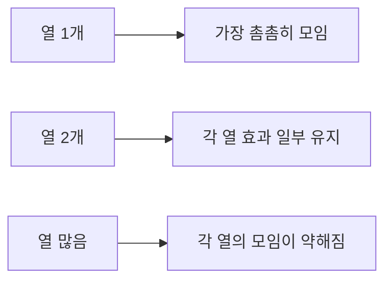
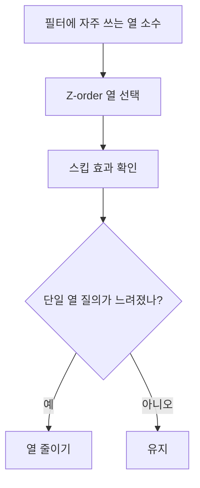

# Z-order 열 수 한계

> Z-order는 **열을 더 넣을수록 각 열의 데이터 모으기가 약해져** 효과가 떨어진다. 그래서 필터에 자주 쓰는 소수의 열만 골라야 한다.

## 쉽게 말하면
책장 한 칸에서 "저자순"과 "출판연도순"을 동시에 만족하려고 하면 둘 다 어정쩡해진다. 기준이 하나일 때 가장 깔끔하게 모이고, 기준을 더할수록 각 기준에 쓰이는 자리가 줄어든다.

## 자세히
(Delta Lake 블로그 "Delta Lake Z-Order"와 Databricks의 데이터 스킵·liquid clustering 문서를 직접 읽었다. 이론적 수식 설명은 읽은 자료에 없다.)
- **Databricks 문서(데이터 스킵 페이지)**: Z-order는 카디널리티가 높고 필터에 자주 나오는 열에 쓰며, **열이 늘수록 효과가 떨어지고 통계가 있는 열에서만** 유용하다. Databricks는 신규 테이블에는 liquid clustering을 권하며 Z-order와는 병용할 수 없다.
- **Delta 블로그의 실험(10억 행, 직접 읽음)**: `id1 = 'id016'` 필터 질의를 초기 테이블(395개 파일)에서 4.51초, 27개 파일로 압축(compaction)한 뒤 4.33초(이 크기에서는 압축 효과가 작다고 설명), **`id1`으로 Z-order한 뒤 0.6초**(일치 행이 25개 파일 중 1개에 있어 나머지는 건너뜀).
- **여러 열(같은 블로그)**: `id1`과 `id2` 둘을 함께 Z-order하면 `id1` 단독, `id2` 단독, 둘 다 조건인 질의가 모두 빨라졌다. `id1`만 Z-order한 테이블은 `id2` 단독 질의를 빠르게 하지 못했다. 더 큰 데이터셋에서는 **다열 Z-order가 `id1` 단독 질의를 오히려 느리게 만들 수 있다**고 블로그가 적는다. `id1` 데이터의 모임(colocation)이 약해지기 때문이다.
- **효과가 없는 경우(블로그)**: 스킵이 가능해질 때만 도움이 된다. `id3`로 그룹화하는 질의는 `id1`로 정렬해도 이득이 없다. 열 선택이 중요하며 열을 더할 때마다 절충이 생긴다. 블로그는 Z-order의 멱등성이나 증분 동작은 다루지 않는다.
- **열 수에 대한 구체 상한**: 위 자료에는 Z-order 열의 하드 상한 숫자가 없다. 반면 liquid clustering 문서는 클러스터링 키를 **최대 4개**로 제한하고 10TB 미만 테이블에서 키가 더 많으면 단일 열 필터가 느려질 수 있다고 한다(이 4개 제한은 liquid clustering의 규칙이며 Z-order에 그대로 적용된다고 단정하지 않는다).
- **이유의 해석(일반)**: 비트 인터리빙은 한 정수에 여러 열의 비트를 나눠 담으므로 열이 늘수록 각 열이 차지하는 비트 자리 비중이 줄어, 한 열 기준의 연속적인 모임이 약해진다.

## 그림으로 보기

## 예시
| 상황 | 결과 |
|---|---|
| `id1`만 Z-order, `id1` 필터 질의 | 395개 파일 4.51초 → 0.6초(블로그 수치) |
| `id1`만 Z-order, `id2` 필터 질의 | 빨라지지 않음(블로그) |
| `id1,id2` Z-order | 양쪽 모두 개선, 큰 데이터에선 `id1` 단독이 느려질 수 있음(블로그) |
- 교육 소재: 책장에 한 가지 기준만 쓰는 것과 두 가지 기준을 섞는 것의 차이.

## 헷갈리는 것과 비교
| 개념 | 차이 |
|---|---|
| Z-order 열 수 한계 | 열이 늘수록 모임이 약해짐 |
| [Liquid clustering](#liquid-clustering) | 키 최대 4개, 키 변경이 쉬운 후속 기법 |
| [비트 인터리빙](#bit-interleaving) | 여러 열을 합치는 계산 |
| [데이터 스킵 통계](#data-skipping-statistics) | 통계가 있는 열만 효과를 봄 |

## 더 읽을거리
- [Delta Lake Z-Order (Delta 블로그)](https://delta.io/blog/2023-06-03-delta-lake-z-order/) — 10억 행 실험, 다열 주의(직접 읽음).
- [Data skipping for Delta Lake (Databricks)](https://docs.databricks.com/aws/en/delta/data-skipping) — 열이 늘수록 효과가 떨어진다는 서술(직접 읽음).
